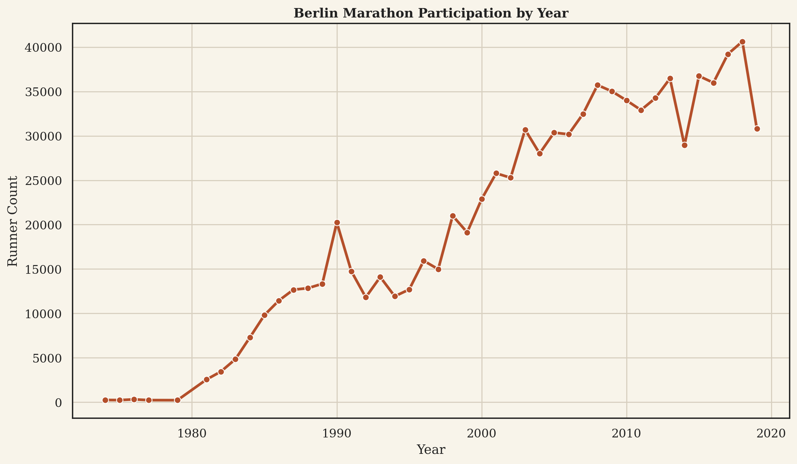
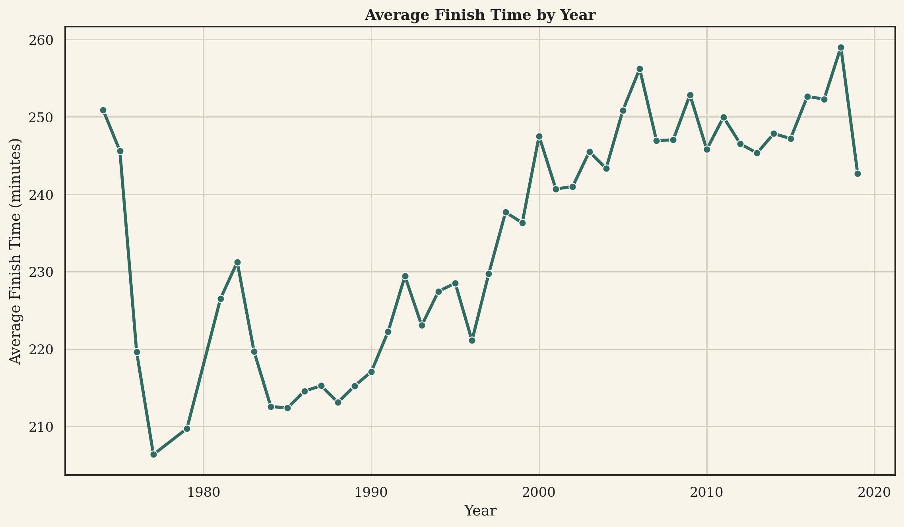
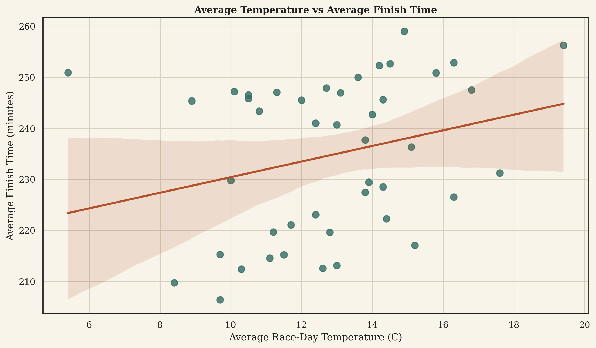
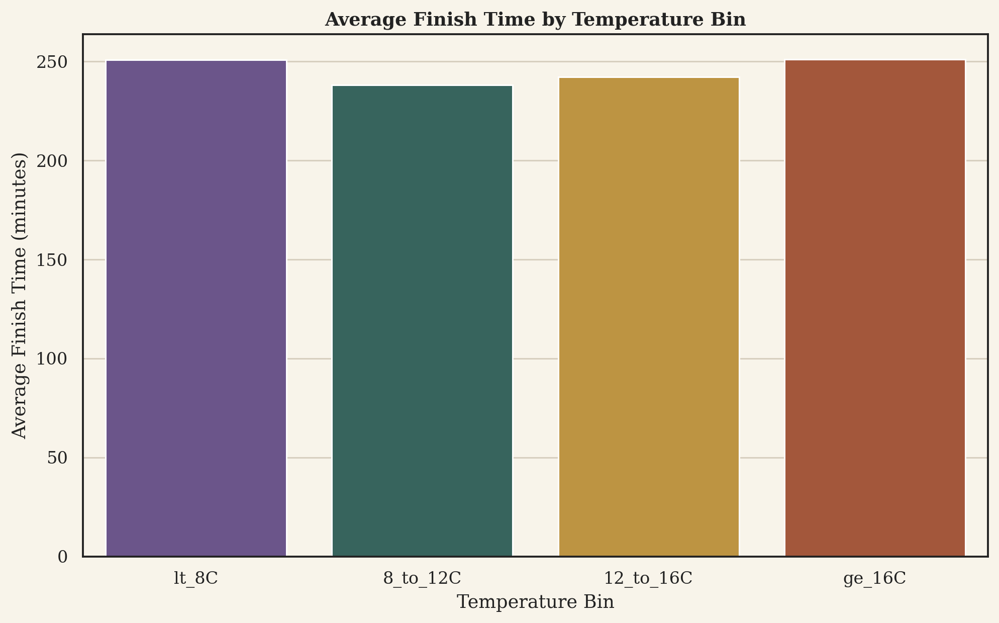
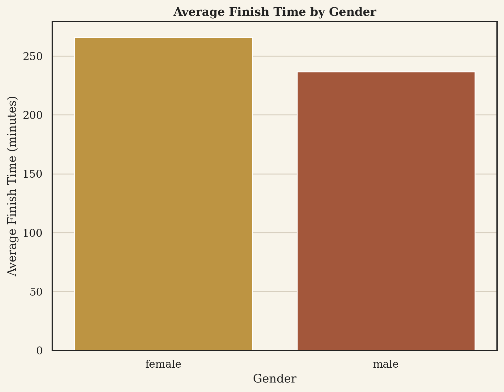
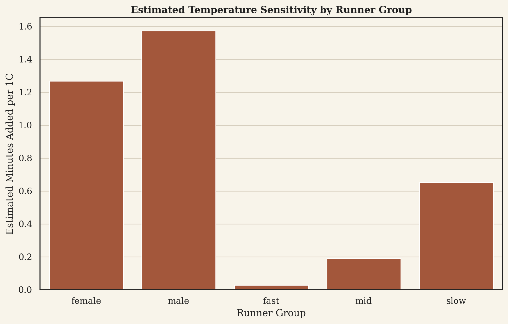
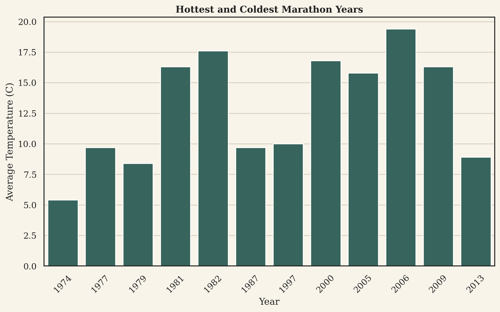

# Introduction

Weather affects every marathon runner on race day. Temperature, humidity, and rain can change hydration, pacing, and fatigue. Because these factors apply to the full field at the same time, marathons are a useful setting for studying environmental effects on endurance performance.

This paper focuses on the Berlin Marathon. We ask three questions: Does race-day temperature affect finishing time? Is the relationship linear or non-linear? Do weather effects differ across runner groups? To answer these questions, we use Berlin Marathon results from 1974 to 2019 and yearly weather data in a distributed Hadoop and Spark workflow.

This project makes two contributions. First, it gives a clear estimate of how temperature is related to marathon performance in a major race. Second, it shows a complete and reproducible big-data pipeline, from raw CSV files in HDFS to final tables and figures. Berlin is a good case because the race has a long history, large participation, and a stable course identity. That lets us study weather effects in one event instead of mixing many races together.

# Previous Work

Previous research already shows that weather matters in marathon running. Cheuvront and Haymes explained the main biological reason: heat makes thermoregulation harder and can reduce endurance performance [@Cheuvront_2001_Marathon_Hyperthermia]. This gives a clear mechanism for why weather should matter on race day.

Several empirical studies found the same general pattern in real races. Vihma showed that weather variables, especially temperature, are related to marathon performance [@Vihma_2009_Weather_Effects_Marathon]. El Helou *et al.* studied nearly 1.8 million marathon results and found that temperature had the strongest environmental effect [@El_Helou_2012_Environmental_Parameters]. Mantzios *et al.* reached a similar conclusion in a larger endurance-sport setting, showing that weather effects are systematic across many races, but the effect is not equally strong in every sport [@Mantzios_2021_Weather_Parameters_Endurance].

Some papers focus on one race over many years. Miller-Rushing *et al.* found that warmer Boston Marathon conditions were linked to slower winning times [@Miller_Rushing_2012_Warming_Temperatures]. Knechtle *et al.* later studied Boston from 1972 to 2018 and found that higher temperature and related weather stress were linked to worse performance across several groups [@Knechtle_2019_Boston_Weather]. These studies are useful because they hold the race context constant.

Other papers focus on differences across runner groups. Gasparetto and Nesseler showed that the same thermal condition does not affect all runners in the same way [@Gasparetto_2020_Thermal_Conditions]. Knechtle *et al.* found similar large-sample weather effects in more than 1.28 million New York City Marathon finishes [@Knechtle_2021_NYC_Master_Runners]. Weiss *et al.* extended this line of work by looking at elite runners [@Weiss_2022_Elite_NYC_Weather] and pacing among age-group runners [@Weiss_2022_Pacing_NYC_Marathon]. Together, these studies show that weather can affect both final time and race pacing, and that the effect may differ by runner type.

Berlin-specific work is especially important for our project. Scheer *et al.* found that cooler and moderate conditions are favorable for elite Berlin Marathon performances [@Scheer_2021_Berlin_Optimal_Conditions]. Weiss *et al.* later showed that environmental factors are still linked to performance in a large Berlin Marathon sample [@Weiss_2024_Berlin_Environmental_Factors]. These papers support our choice to study Berlin directly.

Overall, the literature supports three points. First, warmer conditions usually lead to slower marathon times. Second, the effect is not always the same across runner groups. Third, most prior studies focus on statistical results, not on a shared distributed workflow. Our project builds on these findings by combining runner-level Berlin data, subgroup analysis, and a reproducible HDFS/Spark pipeline.

\begin{table*}[t]
\caption{Representative studies on marathon performance and environmental conditions.}
\label{tbl:previous-work}
\centering
\begin{tabular}{p{2.1cm} p{2.2cm} p{2.8cm} p{3.7cm} p{4.5cm}}
\toprule
Study & Race context & Data scale & Main finding & Limitation relative to this project \\
\midrule
Cheuvront and Haymes (2001) & Review & Conceptual review & Explains why heat and thermoregulation matter for marathon performance. & Not an event-level empirical study. \\
Vihma (2009) & Marathon biometeorology & Event-level observations & Temperature and related weather variables are statistically associated with race outcomes. & Smaller-scale conventional analysis. \\
El Helou et al. (2012) & Paris Marathon & Large observational sample & Environmental variables jointly affect marathon performance. & Focuses on a different marathon and broader weather index. \\
Miller-Rushing et al. (2012) & Boston Marathon & Long-run race series & Warmer race days are linked to slower winning times. & Focuses on winners rather than the full field. \\
Gasparetto and Nesseler (2020) & New York City Marathon & Large runner-level sample & Heat effects differ across runner segments and ability groups. & Different course and climate from Berlin. \\
Knechtle et al. (2021) & New York City Marathon & 1.28 million finishes & Weather effects remain visible in a very large runner-level sample. & Different race context from Berlin. \\
Scheer et al. (2021) & Berlin Marathon elites & Elite/world-class performances & Cooler moderate conditions are most favorable for top Berlin performances. & Elite-only focus rather than full-field runner analysis. \\
Weiss et al. (2024) & Berlin Marathon & Observational Berlin sample & Environmental effects remain detectable in modern Berlin datasets. & Does not foreground a distributed data-engineering workflow. \\
\bottomrule
\end{tabular}
\end{table*}

Table \ref{tbl:previous-work} positions our project relative to the literature. The most relevant gap is not whether weather matters; that question is already fairly settled. The gap is whether a course-scale, runner-level Berlin analysis can be executed in a clean and reproducible distributed environment while still producing simple, interpretable results. That is the niche this project fills.

# Methodology

## Data and Processing Pipeline

The project uses two datasets: a runner-level Berlin Marathon results file and a weather summary file, both covering 1974 to 2019. The raw runner-level data was compiled from the Berlin Marathons Data collection [@David_2023_Berlin_Marathons_Data]. The results table includes `YEAR`, `COUNTRY`, `GENDER`, `AGE`, and `TIME`. The weather table includes yearly precipitation, sunshine hours, cloud hours, pressure, and minimum, average, and maximum temperatures. The two tables are linked by `YEAR`.

The distributed workflow is implemented on a Linux virtual machine with Hadoop and Spark. Raw CSV files are uploaded to HDFS, read by PySpark, cleaned and joined, and then written back to HDFS as parquet. EDA and modeling scripts read the parquet output and export compact CSV tables for reporting. This design keeps storage, processing, and reporting outputs separate, and it lets every team member run the same workflow.

The ETL process has four main steps. First, it parses `TIME` from `HH:MM:SS` into total seconds and minutes. Second, it removes malformed time strings and filters finish times below 2 hours or above 10 hours. Third, it keeps the raw `AGE` field and also creates a conservative grouped version, because the original column mixes numeric ages with coded labels. Fourth, it joins the cleaned results to yearly weather records and creates analysis variables such as `temperature_bin`, `performance_group`, and `avg_temp_squared`.

After cleaning, the final dataset contains 882,539 runner-level observations across 44 race years. The average finishing time is 241.76 minutes and the median is 237.43 minutes. The average race-day temperature varies from 5.4°C to 19.4°C.

\begin{table}[t]
\caption{Summary of the cleaned analysis dataset.}
\label{tbl:data-summary}
\centering
\begin{tabular}{lr}
\toprule
Metric & Value \\
\midrule
Runner-level observations & 882,539 \\
Race years & 44 \\
Study period & 1974--2019 \\
Average finish time (min) & 241.76 \\
Median finish time (min) & 237.43 \\
Average temperature range (°C) & 5.4--19.4 \\
Male runners & 724,135 \\
Female runners & 158,404 \\
\bottomrule
\end{tabular}
\end{table}

Table \ref{tbl:data-summary} shows that the cleaned dataset remains large after filtering and therefore retains the scale necessary for meaningful grouped analysis. The strong imbalance between male and female observations reflects historical participation patterns in marathon running, not a filtering artifact.

To improve consistency across team members, we fixed one shared processing order instead of allowing separate local transformations. The workflow is simple: read the raw CSV files, run ETL to create one cleaned parquet dataset, run EDA and modeling from that parquet output, and then generate figures from the saved summary tables. This matters because all reported coefficients, grouped means, and figure inputs come from the same intermediate dataset rather than from separate notebook-level preprocessing choices.

We also made a few practical choices to keep the pipeline stable. We stored the cleaned dataset in parquet instead of CSV because parquet is easier for repeated analytical reads in Spark. We also wrote the final summaries as small CSV files because they are easy to inspect and easy to use in figures and tables. These choices are simple, but they help separate heavy processing from final reporting.

We recorded the outputs of each stage separately. The ETL step writes the joined parquet dataset. The EDA step writes grouped summary tables. The modeling step writes regression tables and grouped slope tables. This makes debugging easier because we can inspect each stage without rerunning the whole pipeline, and it ensures that the report tables come directly from saved program outputs.

\begin{table}[t]
\caption{Main workflow stages and outputs.}
\label{tbl:workflow}
\centering
\begin{tabular}{lll}
\toprule
Stage & Main tool & Output \\
\midrule
Ingestion & HDFS & Raw CSV files \\
ETL & PySpark & Cleaned parquet \\
EDA & PySpark & Summary CSV tables \\
Modeling & pyspark.ml & Regression CSV tables \\
Figures & pandas/matplotlib & Report figures \\
\bottomrule
\end{tabular}
\end{table}

Table \ref{tbl:workflow} summarizes the project pipeline. It also shows why the report is easy to reproduce: each stage has one clear purpose and one clear output.

## Variables and Models

The primary outcome variable is `finish_time_minutes`. The main explanatory variable is `AVG_TEMP_C`, the average race-day temperature. To test non-linearity, we also include `avg_temp_squared`, the squared average temperature. Grouped analyses use `performance_group` with thresholds of under 3 hours (`fast`), 3 to 4 hours (`mid`), and above 4 hours (`slow`), along with `GENDER` and temperature bins (`<8°C`, `8–12°C`, `12–16°C`, `≥16°C`).

We estimate two baseline models with `pyspark.ml`. We use `PySpark` for ETL and aggregation, `pyspark.ml` for regression, and `pandas`, `matplotlib`, and `seaborn` for final figures. We first fit a linear model using average temperature as the main predictor. We then fit a quadratic model by adding the squared temperature term to test for a non-linear relationship.

The first model provides an easily interpretable average marginal effect of temperature. The second tests whether the weather-performance relationship is better described by a U-shaped curve. We also fit separate linear models for gender and performance groups so that temperature slopes can be compared directly across runner segments.

Our modeling strategy is intentionally simple. The goal is not to build the best predictive model. The goal is to test whether the weather signal appears clearly in transparent models that are easy to explain and reproduce.

This choice also matches the data. Weather is linked at the year level, so a simple model is easier to interpret. It is also enough to answer the main question of this project.

## Distributed Implementation

The distributed implementation also supports reproducibility. Raw files are staged in HDFS, Spark performs cleaning and joining, and the joined runner-level dataset is saved as parquet for later analysis. Final summary tables are saved as CSV because they are easy to inspect and reuse in the report.

This pipeline standardizes team work. Every team member runs the same ETL, EDA, and modeling steps in the same VM environment. That reduces the risk of inconsistent outputs caused by different local setups or different local processing.

This is an important part of the project design. In many class projects, the final report is correct but hard for teammates to reproduce because each person uses a different local environment. Our workflow reduces that problem. The same scripts, the same VM setup, and the same intermediate files are used by everyone in the group.

# Results

## Descriptive Findings

The distributed ETL process preserved nearly the full sample while removing malformed or implausible entries. The final table covers 44 years and more than 882 thousand runners, making the Berlin Marathon large enough for distributed processing while still narrow enough for interpretable modeling. The key descriptive result is already visible in grouped averages: moderate cool conditions correspond to faster average finish times, whereas hotter years are associated with slower outcomes.

This descriptive pattern is important because it appears before any regression model is fitted. In other words, the main result is already visible in the raw grouped summaries. The later models do not create the temperature effect. They only measure it more clearly.

This also improves the credibility of the final claim. If the direction of the result only appeared in one model, it would be harder to trust. Here, the same pattern appears in yearly summaries, temperature bins, and subgroup comparisons.

{#fig-participation width=100%}

@fig-participation shows that participation increased strongly over time, particularly after the 1980s. This matters methodologically because later years contribute much more weight to runner-level models than earlier years. It also means that modern heat effects are being estimated from large participation cohorts rather than from sparse early-race fields.

{#fig-yearly-time width=100%}

@fig-yearly-time shows that average finish time also changes over time, although less monotonically than participation. This pattern is consistent with a shifting race composition in which the Berlin Marathon gradually expanded from a smaller competitive field to a much broader mass-participation event. The existence of this temporal variation is one reason we interpret temperature coefficients as partial summaries of race-year conditions rather than as the only force driving long-run changes in performance.

{#fig-temp width=100%}

@fig-temp shows a positive association between yearly average temperature and yearly average finish time. While the spread is not large enough to explain all runner-level variation, the direction is consistent across the time series: warmer years tend to produce slower race outcomes.

This figure is useful because it gives a year-level view of the same relationship later tested at the runner level. It also shows why a pure time trend is not enough to explain performance. Some years are noticeably slower even when participation is high, and temperature helps explain part of that difference.

{#fig-bin width=100%}

@fig-bin sharpens this interpretation. The `8–12°C` bin has the lowest average finish time at roughly 238.09 minutes, while the `≥16°C` bin has the highest average finish time at roughly 251.12 minutes. This pattern suggests that cool moderate conditions are advantageous and that substantial heat is performance-reducing.

\begin{table}[t]
\caption{Average performance by temperature bin.}
\label{tbl:temp-bins}
\centering
\begin{tabular}{lrr}
\toprule
Temperature bin & Runners & Avg. finish time (min) \\
\midrule
$< 8^\circ$C & 244 & 250.88 \\
$8$--$12^\circ$C & 288,714 & 238.09 \\
$12$--$16^\circ$C & 499,511 & 242.11 \\
$\ge 16^\circ$C & 94,070 & 251.12 \\
\bottomrule
\end{tabular}
\end{table}

Table \ref{tbl:temp-bins} adds two useful details. First, the coolest bin contains very few observations, so it should not be over-interpreted as evidence that extremely cool conditions are generally best. Second, the hotter tail is not rare in Berlin: the 16°C or higher bin still contains more than 94 thousand runners. That makes the observed slowdown under hot conditions substantively important rather than a niche edge case.

The grouped bin result is also easy to explain to a non-technical audience. The fastest average outcomes do not appear in the hottest years. They appear in moderate cool conditions. That simple pattern supports the more formal regression results that follow.

It is also useful for the report because it turns the main result into a clear visual comparison. A reader does not need to inspect the regression table first to understand the direction of the effect.

## Baseline Models

Table \ref{tbl:models} reports the two baseline temperature models.

\begin{table}[t]
\caption{Baseline Spark regression results.}
\label{tbl:models}
\centering
\begin{tabular}{lrrrr}
\toprule
Model & Intercept & Temp. coef. & Temp.\textsuperscript{2} coef. & $R^2$ \\
\midrule
Linear & 222.26 & 1.49 &  & 0.0069 \\
Quadratic & 266.79 & -5.29 & 0.25 & 0.0090 \\
\bottomrule
\end{tabular}
\end{table}

The linear model shows that each 1°C increase in average race-day temperature is associated with about 1.49 more finishing minutes. The quadratic model fits slightly better and implies a turning point near 10.6°C. This matches the descriptive result that the `8–12°C` bin looks best. The R-squared values are low, but that is expected because many runner-level factors are not observed in the data.

The low R-squared does not mean temperature is unimportant. It means weather is only one part of a runner's final time. Even so, a one- to two-minute average slowdown per 1°C is meaningful in marathon racing.

The quadratic model is especially useful for interpretation. A linear model says hotter is slower on average. The quadratic model adds a more precise claim: performance seems best in a moderate range and gets worse as temperature moves away from that range. This interpretation fits both the grouped summaries and the Berlin-specific studies reviewed earlier.

The regression table is therefore useful in two ways. It gives a simple coefficient that is easy to report, and it gives a non-linear check that supports the descriptive plots. These two views make the results section stronger than using only one of them.

## Heterogeneity Across Runner Groups

Weather effects are not uniform across runner groups. Male runners average about 236.48 minutes, while female runners average about 265.88 minutes in the cleaned sample. More important than the mean difference, however, is how temperature sensitivity varies across groups.

{#fig-gender width=88%}

@fig-gender shows the baseline difference in average performance level by gender. This figure should not be interpreted causally; it simply establishes the scale difference in the sample before comparing temperature slopes.

{#fig-groups width=100%}

@fig-groups shows the estimated linear temperature slope for selected subgroups. The gender-specific results indicate approximately 1.27 additional minutes per 1°C for women and 1.57 additional minutes per 1°C for men. The performance-group results are more pronounced: about 0.03 minutes per 1°C for `fast` runners, 0.19 for `mid`, and 0.65 for `slow`. This ranking is consistent with the hypothesis that longer exposure time amplifies the weather penalty for slower runners.

\begin{table}[t]
\caption{Grouped linear temperature slopes.}
\label{tbl:group-slopes}
\centering
\begin{tabular}{lr}
\toprule
Group & Additional minutes per 1°C \\
\midrule
Female & 1.27 \\
Male & 1.57 \\
Fast & 0.03 \\
Mid & 0.19 \\
Slow & 0.65 \\
\bottomrule
\end{tabular}
\end{table}

Table \ref{tbl:group-slopes} makes the heterogeneity result explicit. The difference between `fast` and `slow` runners is especially important because it matches the broader literature's argument that exposure duration matters. In practical terms, a hot Berlin Marathon is likely to be much more consequential for recreational runners than for the front of the field.

This is one of the most useful findings in the paper. It shows that the effect of weather is not only a field-wide average. It also changes across runner types. That makes the result more practical. A race organizer, coach, or runner can use this kind of evidence more easily than a single overall coefficient.

The subgroup result also helps explain why yearly heat effects can be large even when some runners are less affected. A very small penalty for fast runners and a larger penalty for slow runners can still produce a clear field-level slowdown in hot years.

## Extreme Race Years

{#fig-extremes width=100%}

@fig-extremes highlights the hottest and coldest Berlin Marathon years. The warmest race years cluster at the upper end of the temperature distribution and align with slower average finish times than the coldest years. This does not mean cold conditions are always ideal, but it reinforces the broader result that extreme warmth is consistently harmful for marathon performance.

Overall, the empirical evidence supports three claims. First, higher race-day temperature is associated with slower finishing times. Second, the relationship is better characterized as non-linear than purely linear. Third, weather sensitivity differs by runner type, with the strongest penalties appearing among slower participants.

These results are internally coherent across descriptive summaries, grouped comparisons, and baseline regressions. That coherence is important because no single specification is especially complex. The same directional conclusion appears repeatedly across several transparent views of the data. This consistency makes the result more convincing.

The results section also shows the value of the distributed workflow. The raw dataset is large enough to justify distributed processing, but the final conclusions remain simple and interpretable. That balance is important. The project is not only technically sound. It is also easy to explain.

This balance is one of the main strengths of the report. The project does not use distributed tools only for appearance. It uses them because the dataset is large and because the workflow must be shared by the whole team. At the same time, the final outputs remain clear enough for a reader who is more interested in the findings than in the implementation details.

\begin{table}[t]
\caption{Summary answers to the research questions.}
\label{tbl:answers}
\centering
\begin{tabular}{p{2.6cm} p{5.2cm}}
\toprule
Question & Answer \\
\midrule
Does temperature affect finish time? & Yes. Warmer race days are linked to slower average finish times. \\
Is the effect linear? & Not fully. The quadratic model suggests a best range near 10.6°C. \\
Do groups differ? & Yes. Slower runners show larger temperature penalties than faster runners. \\
Why use Spark/HDFS? & The dataset is large, and the shared workflow improves reproducibility. \\
\bottomrule
\end{tabular}
\end{table}

Table \ref{tbl:answers} connects the results back to the three research questions in the introduction. This makes the logic of the paper easier to follow and helps show that each question was answered directly.

# Discussion

The results align well with earlier work. Like Vihma and El Helou *et al.*, we find that warmer conditions are linked to slower performances [@Vihma_2009_Weather_Effects_Marathon; @El_Helou_2012_Environmental_Parameters]. Like Gasparetto and Nesseler, we also find meaningful differences across runner groups [@Gasparetto_2020_Thermal_Conditions]. The Berlin-specific studies by Scheer *et al.* and Weiss *et al.* are also consistent with our result that cooler moderate conditions are more favorable [@Scheer_2021_Berlin_Optimal_Conditions; @Weiss_2024_Berlin_Environmental_Factors].

Our paper adds two things. First, we study the full runner-level field instead of only winners or elites. Second, we present the work as a reproducible distributed pipeline, not just as a set of statistical outputs. This makes the analysis easier to reproduce and easier to inspect.

The results also have a simple practical meaning. For runners, the findings suggest that hotter Berlin race days should lead to more conservative expectations and pacing. For organizers, the same findings support more attention to heat-related preparation in warmer years. We do not estimate medical risk directly, but the performance pattern still has operational value.

There are several limitations. Weather is linked at the race-year level, so all runners in the same year get the same environmental summary. The data does not capture within-race differences such as pacing-based heat exposure or hydration. The age field is also only partly standardized. Finally, the current models are simple and do not include all possible weather interactions.

Even with these limitations, the current design remains appropriate for the main goal of the study. The point is not to claim a definitive causal estimate for marathon heat stress. The point is to show that a distributed workflow can produce coherent, literature-consistent evidence from a large runner-level dataset, while remaining transparent and reproducible. On that basis, the project succeeds: the computational path is unified, the descriptive and model-based results agree, and the conclusions align with prior marathon-weather research without requiring unnecessarily complex machinery.

# Conclusion

This paper studied weather effects on Berlin Marathon performance with a distributed HDFS and Spark workflow. Using data from 1974 to 2019, we found that warmer race conditions are linked to slower finishing times. The quadratic model and grouped summaries both suggest that moderate cool conditions are best, and the subgroup analysis shows that slower runners are more sensitive to heat than faster runners.

The project also has clear limitations. Weather is measured at the race-year level, the age field is only partly standardized, and the models are intentionally simple. Still, the main result is consistent across figures, tables, and regressions. The project therefore shows that distributed tools can support a clear and reproducible sports analytics study.

More broadly, the project shows that a sports analytics question can be framed as both a research problem and a data-engineering problem. The report presents a simple question, a reproducible workflow, and a result that is supported in several ways by the data.

The final takeaway is direct. In the Berlin Marathon, warmer race conditions are linked to slower results, and the penalty is larger for slower runners. That finding is simple, useful, and supported by both the literature and our own distributed analysis.

Future work could extend this study in several ways. One direction is to compare Berlin with other major marathons using the same workflow. Another is to add interaction terms for temperature, precipitation, sunshine, and other weather variables. A third is to use pacing or split data, which would allow a more detailed analysis of how weather affects race strategy during different parts of the marathon.
